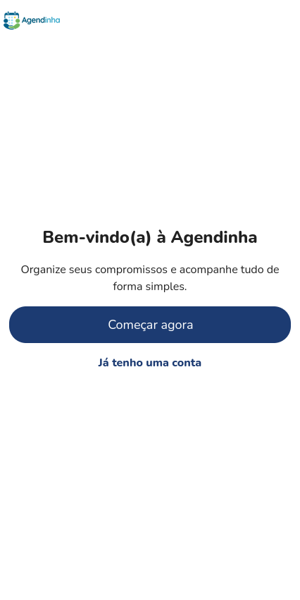

  

<h1 align="center">Agendinha</h1>

## Objetivo

### *Gerais:*

- Montar uma agenda em detalhes, a partir de um calendário;
- Exibir informações sobre contatos de médicos e funcionários;
- Marcar consultas e exames, tanto para pacientes quanto para profissionais.

### *Específicos:*

- Transferir dados de uma agenda para o dispositivo móvel de forma local ou em nuvem (ex.: Google Calendar).

## **Público Alvo**

Funcionários da instituição, médicos, enfermeiros e pais/responsáveis.

## **Tecnologias Utilizadas**

- **Front-end**: Nuxt (Vue.js, Nitro, Vite);

- **Back-end**: versão inicial com Spring Boot (microsserviços); versão atual com Django (monolítico).

## **Como Rodar o Projeto**

**1.** Instale Node.js e npm;

**2.** Clone o repositório e entre na pasta `agendinha-web`;

**3.** Faça uma cópia de `.env.example` com o nome de `.env` e prepare as variáveis de ambiente;

**4.** Execute `npm install` ou `npm i`. Você também pode usar o Makefile com `make` (se fez dessa maneira, pode pular o passo 5);

**5.** Execute `npm run dev`.

## **Protótipo**

[Link para o Figma](https://www.figma.com/design/YcsePD84W6dDpqlqEI1Uij/Prot%C3%B3tipos?node-id=0-1&p=f&t=aCiNfIbbh89TsGnt-0)

## **Imagens do Aplicativo**

### **Página de Boas-vindas**

### **Página de Login**

### **Página de Contatos**

### **Página Inicial — Agendamentos**

### **Página Inicial — Calendário**

### **Detalhe do Compromisso**

### **Página de Perfil**

## **Status**

- [ ] Em ideação
- [x] Em desenvolvimento
- [ ] Testando com usuário
- [ ] Em uso
- [ ] Descontinuado
