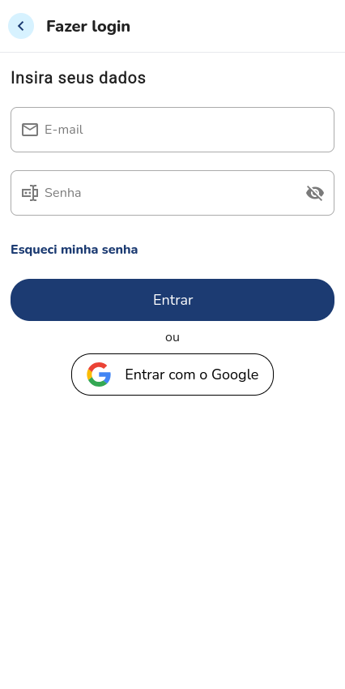
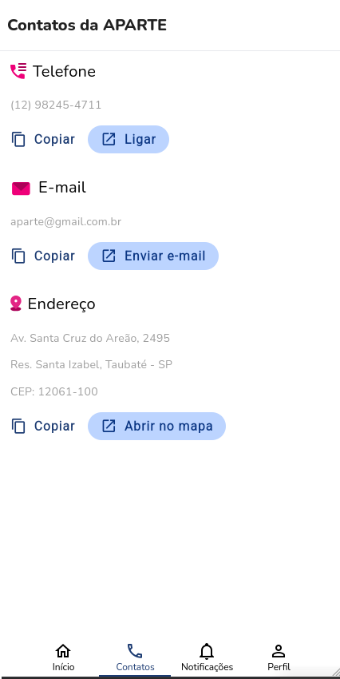
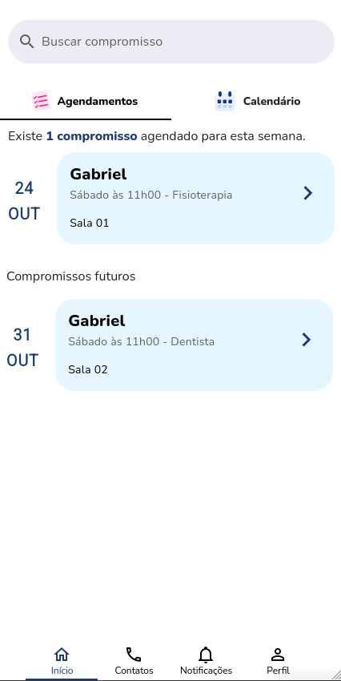
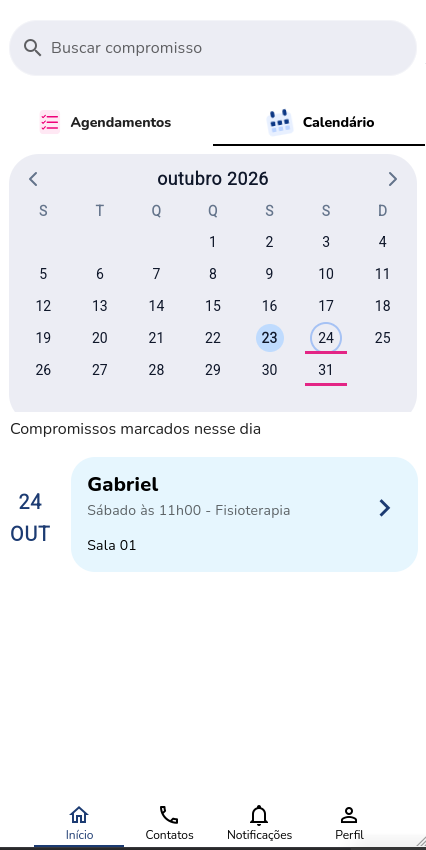
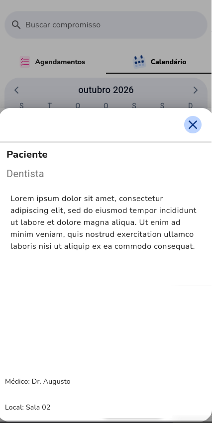
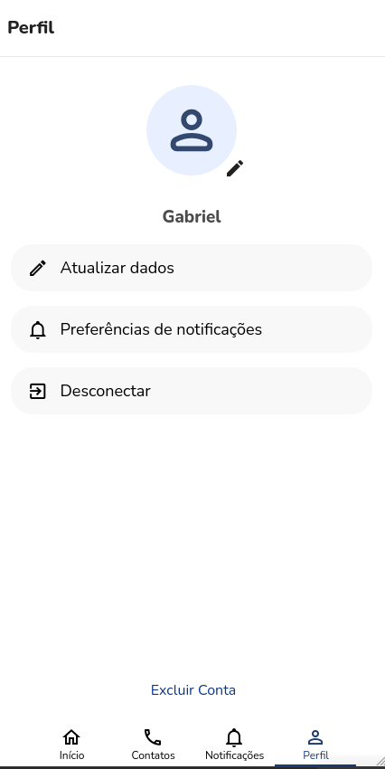

<p align="center">
  
</p>

<h1 align="center">Agendinha</h1>

## Objetivo

### _Gerais:_

- Montar uma agenda em detalhes, a partir de um calendário;
- Exibir informações sobre contatos de médicos e funcionários;
- Marcar consultas e exames, tanto para pacientes quanto para profissionais.

### _Específicos:_

- Transferir dados de uma agenda para o dispositivo móvel de forma local ou em nuvem (ex.: Google Calendar).

## **Público Alvo**

Funcionários da instituição, médicos, enfermeiros e pais/responsáveis.

## **Tecnologias Utilizadas**

- **Front-end**: Nuxt (Vue.js, Nitro, Vite);

- **Back-end**: versão inicial com Spring Boot (microsserviços); versão atual com Django (monolítico).

### Principais bibliotecas e recursos

- **UI**: [Vuetify](https://vuetifyjs.com/) e [Material Design Icons](https://pictogrammers.com/library/mdi/);
- **Estado**: [Pinia](https://pinia.vuejs.org/);
- **PWA**: [`@vite-pwa/nuxt`](https://vite-pwa-org.netlify.app/frameworks/nuxt) (instalável e com atualização automática);
- **Autenticação e integração Google**: login com Google e integração com o Google Calendar;
- **Notificações**: Web Push (VAPID) e toasts de interface;
- **Calendário**: [v-calendar](https://vcalendar.io/) e [Schedule-X](https://schedule-x.dev/).

## **Pré-requisitos**

- [Node.js](https://nodejs.org/) **20.x ou superior** (recomendada a versão LTS ativa);
- **npm** (acompanha o Node.js).

## **Como Rodar o Projeto**

**1.** Instale o Node.js e o npm (ver pré-requisitos acima);

**2.** Clone o repositório e entre na pasta `agendinha-web`;

**3.** Faça uma cópia de `.env.example` com o nome de `.env` e preencha as variáveis de ambiente (ver seção abaixo);

**4.** Execute `npm install` ou `npm i`. Você também pode usar o Makefile com `make` (se fez dessa maneira, pode pular o passo 5);

**5.** Execute `npm run dev`. A aplicação ficará disponível em `http://localhost:3000`;

**6.** *(Opcional)* Para executar o back-end, acesse o [repositório do back-end](https://github.com/UnifespCodeLab/agendinha-backend-simple) e siga as instruções de lá.

## **Variáveis de Ambiente**

Copie `.env.example` para `.env` e preencha os valores:

| Variável | Descrição |
| --- | --- |
| `NUXT_PUBLIC_API_BASE` | URL base da API de back-end (ex.: `http://localhost:8080/`). |
| `NUXT_GOOGLE_CLIENT_ID` | Client ID do OAuth do Google, usado no login e na integração com o Google Calendar. Obtido no [Google Cloud Console](https://console.cloud.google.com/apis/credentials). |
| `NUXT_VAPID_PUBLIC_KEY` | Chave pública VAPID para notificações Web Push. |
| `NUXT_VAPID_PRIVATE_KEY` | Chave privada VAPID para notificações Web Push. Mantenha em segredo e não a exponha no cliente. |

## **Scripts Disponíveis**

| Script | O que faz |
| --- | --- |
| `npm run dev` | Inicia o servidor de desenvolvimento. |
| `npm run dev:host` | Inicia o servidor de desenvolvimento exposto na rede local. |
| `npm run build` | Gera a build de produção. |
| `npm run preview` | Pré-visualiza a build de produção localmente. |
| `npm run generate` | Gera uma versão estática do site. |
| `npm run lint:eslint` | Verifica o código com o ESLint. |
| `npm run lint:prettier` | Verifica a formatação com o Prettier. |
| `npm run lint:fix` | Corrige automaticamente problemas do ESLint. |
| `npm run lint:full` | Roda ESLint com correção e aplica a formatação do Prettier. |

## **Estrutura de Pastas**

```text
agendinha-web/
├── app/                # Código da aplicação (Nuxt 4)
│   ├── assets/         # CSS, fontes e ícones
│   ├── components/     # Componentes Vue reutilizáveis
│   ├── composables/    # Composables (lógica reutilizável)
│   ├── middleware/     # Middlewares de rota (ex.: autenticação)
│   ├── pages/          # Páginas e rotas da aplicação
│   ├── plugins/        # Plugins do Nuxt (ex.: cliente de API)
│   ├── stores/         # Stores do Pinia
│   └── utils/          # Funções utilitárias
├── shared/
│   └── types/          # Tipos TypeScript compartilhados
├── public/             # Arquivos estáticos (imagens, favicon, service worker)
└── nuxt.config.ts      # Configuração do Nuxt
```

## **Protótipo**

[Link para o Figma](https://www.figma.com/design/YcsePD84W6dDpqlqEI1Uij/Prot%C3%B3tipos?node-id=0-1&p=f&t=aCiNfIbbh89TsGnt-0)

## **Imagens do Aplicativo**

### **Página de Boas-vindas**


### **Página de Login**



### **Página de Contatos**



### **Página Inicial — Agendamentos**



### **Página Inicial — Calendário**



### **Detalhe do Compromisso**



### **Página de Perfil**



## **Status**

- [ ] Em ideação
- [x] Em desenvolvimento
- [ ] Testando com usuário
- [ ] Em uso
- [ ] Descontinuado
